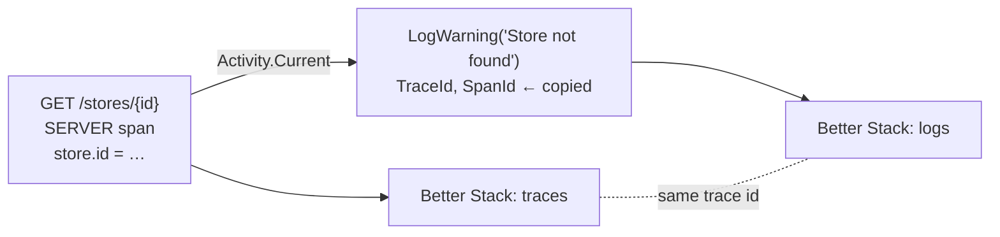

# Phase 7 — Logs and trace correlation

**Question answered:** should log messages carry business specifics, or stay
generic?

**Status:** implemented. No package added — the logging provider ships in
`OpenTelemetry.Extensions.Hosting`, installed in phase 5.

---

## What changes

| File | Change |
|---|---|
| `Program.cs` | A second OpenTelemetry pipeline, `.WithLogging(...)`, exporting `ILogger` records to Better Stack over OTLP. |
| `Program.cs` | `GET /stores/{id}` takes an `ILogger<Program>`, tags the request span with `store.id`, and logs `Store found` or `Store not found`. |
| `Program.cs` | The Resource gains `host.name`, beside `deployment.environment.name`. |
| `appsettings.json` | `System.Net.Http.HttpClient.OtlpTraceExporter` lowered to `Warning`. |
| `appsettings.Development.json` | Single-line console output with a timestamp, so a log line is readable in a terminal. |

---

## The rule this phase demonstrates

**Messages stay generic. Identity lives on the span. The trace ID joins them.**

```csharp
logger.LogWarning("Store not found");          // this phase
logger.LogWarning("Store {StoreId} not found", id);  // not this
```

The second line is not wrong — `{StoreId}` is a structured property, not string
concatenation — but it puts the same fact in two places. The store id is already
a span attribute (`store.id`, phase 2). Duplicating it into every message means
the log becomes the place people search, and phase 2's whole point was that
searching text for a raw value is the problem being solved.

Finding one store's failure, then, is two steps:

1. Filter **traces** by `store.id`.
2. Open that trace and read **its logs**.

Never the reverse — never text-search logs for an id.

---

## Correlation is not code

There is no line anywhere that copies a trace id into a log record. The
OpenTelemetry logging provider reads `Activity.Current` when a log call happens
and stamps the record's `TraceId`, `SpanId` and `TraceFlags` from it. In ASP.NET
Core, a log written while handling a request is therefore correlated with that
request's span automatically.

The corollary: a log written **outside** any activity — at startup, say — has no
trace id. Correlation depends on the ambient context from phase 3, not on the
logger.



---

## Two pipelines, not one

`WithTracing` never touched `ILogger`. That is why, before this phase, log lines
reached the terminal but not Better Stack. `WithLogging` is a separate pipeline
with its own exporter:

| | Traces | Logs |
|---|---|---|
| Builder | `.WithTracing(...)` | `.WithLogging(...)` |
| OTLP path | `/v1/traces` | `/v1/logs` |
| Source, token, transport | same | same |

`AddOtlpExporter` inside `WithLogging` does not append the signal path for us,
so `/v1/logs` is written in full.

There is no `ClearProviders()`. The OpenTelemetry provider is added *beside* the
built-in console one, so every log call goes to both the terminal and Better
Stack.

---

## A failure with no exception

`GET /stores/{id}` returning `404` is a failure nothing else records: no
exception is thrown, so phase 3's handler never runs and the span's status stays
`Unset`. The `Store not found` warning is the only record of *why* that request
failed. This is what logs are for in a traced system — the event-shaped facts a
span's status and attributes cannot hold.

---

## `host.name`: a resource attribute, not an enricher

`deployment.environment.name` says *which environment*. It cannot say *which
machine*: the same environment can run on more than one, and phase 8 will put a
second `Production` process in the cloud. `host.name` (from
`Environment.MachineName`) closes that gap.

It is added to the **Resource**, not set by an enricher on each span, because
the semantic conventions reserve the `host.*` namespace for resource attributes.
The test is the same one from phase 5: it describes the process, not the
request. Every span and every log record that process exports inherits it.

---

## The exporter's own HTTP logs

The OTLP trace exporter sends through an `HttpClient` created by
`IHttpClientFactory`, and the factory logs each request at `Information` under
`System.Net.Http.HttpClient.OtlpTraceExporter`. Left alone, every export batch
prints lines that have nothing to do with the application. Raising that one
category to `Warning` keeps failures visible and drops the routine noise.

---

## Verify

1. `GET /stores/{id}` with an unknown id → `404`, and the terminal prints a
   single-line `Store not found` warning.
2. In Better Stack, open that request's trace (its id is in the `traceparent`
   response header) and find the warning attached to it — same trace id, no
   `store.id` in the message.
3. A known id → `Store found`, correlated the same way.
4. Every span and log record carries `host.name` and
   `deployment.environment.name` from the Resource.

---

## Concepts this phase answers

- Generic messages with identity on the span, and why duplicating the id into
  messages undoes phase 2.
- Log–trace correlation is automatic, driven by `Activity.Current`, and absent
  outside an activity.
- Traces and logs are separate OpenTelemetry pipelines sharing one Resource.
- Logs record failures that have no exception.
- Process-level facts (`host.name`) belong on the Resource.

## Sources

- [Log correlation — OpenTelemetry .NET](https://opentelemetry.io/docs/languages/dotnet/logs/correlation/)
- [Host resource semantic conventions](https://opentelemetry.io/docs/specs/semconv/resource/host/)
